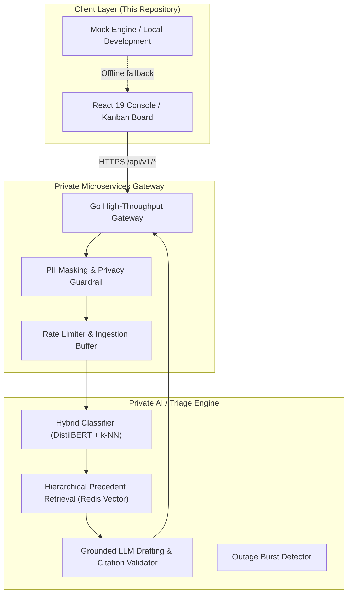

# SentinelDesk — Incident Triage & Automation Console

[](https://sentineldesk-showcase.vercel.app)
[](https://react.dev/)
[](https://tailwindcss.com/)
[](https://vitejs.dev/)

> **Interactive Enterprise Console for Automated Multilingual Incident Triage, Escalation Gates, and Precedent-Grounded AI Reply Drafting.**

🔗 **Live Production App**: [sentineldesk-showcase.vercel.app](https://sentineldesk-showcase.vercel.app)  
🎥 **Demo Walkthrough**: [youtu.be/UBkSEnIPQRM](https://youtu.be/UBkSEnIPQRM)

---

## 🏛️ System Architecture

SentinelDesk bridges high-throughput customer incident streams with low-latency LLM triage and zero-hallucination precedent grounding.



> 🔒 **Source Protection Notice**:  
> This public showcase repository hosts the **React client console, UI design system, and client-side simulation engine**.  
> The backend Go microservices, proprietary Python ML pipeline, vector database indexing, and fine-tuned prompt validators are maintained in a private repository.

---

## ✨ Console Features

| Route | Feature | Description |
| :--- | :--- | :--- |
| `#/` | **Triage Dashboard** | Real-time SLA counters, triage tabs (Needs Action, Escalated, Auto-Drafted, Degraded), bulk operations, and latency telemetry. |
| `#/board` | **Kanban Board** | Multi-lane operational workflow (`Incoming` ➔ `Escalated` ➔ `Human Review` ➔ `Draft Ready` ➔ `Resolved`) with keyboard accessibility. |
| `#/ticket/:id` | **Ticket Deep Dive** | Model confidence scores, top-3 class probabilities, precedent citation chips (`[TKT-xxxxx]`), and grounded drafts. |
| `#/funnel` | **Incident Funnel** | Interactive conversion funnel with queue, priority, and multilingual language breakdowns. |
| `#/insights` | **Performance Telemetry** | Macro-F1 accuracy reports, ECE calibration charts, and holdout benchmark curves. |
| **Top Bar** | **Outage Burst Simulator** | Simulates a sudden cluster of VPN outage incidents to trigger real-time incident escalation banners. |

---

## 🚀 Quick Start (Local Run)

This repository includes a zero-dependency client-side mock engine (`src/api/mockEngine.js`), allowing you to test the complete triage console locally with no backend setup required.

```bash
# 1. Install dependencies
npm install

# 2. Run local development server
npm run dev
# ➔ Open http://localhost:5173

# 3. Run test suite
npm test
```

---

## 📊 Evaluation & Benchmark Highlights (Holdout Set)

Evaluated on the 20% holdout split (8,034 unseen tickets) from customer support benchmarks:

* **Type Classification (4 classes)**: Macro-F1 **0.894** (Accuracy: 89.1%)
* **Priority Routing (3 levels)**: Macro-F1 **0.704** (Accuracy: 71.8%)
* **Queue Triage (10 queues)**: Macro-F1 **0.639** (Accuracy: 65.5%)
* **Classification Latency**: **9.0 ms** per ticket (p50 offline)
* **Precedent Grounding**: Strict citation validator requiring cited ticket IDs to exist within retrieved evidence.

---

## 📜 License & Intellectual Property

**Copyright © 2026 Shaun Lin & SentinelDesk Contributors. All Rights Reserved.**

This repository is made publicly available strictly for **demonstration, portfolio evaluation, and architectural review**.  
No license is granted to copy, modify, distribute, or commercially exploit any portion of this source code or design assets without prior written consent.
